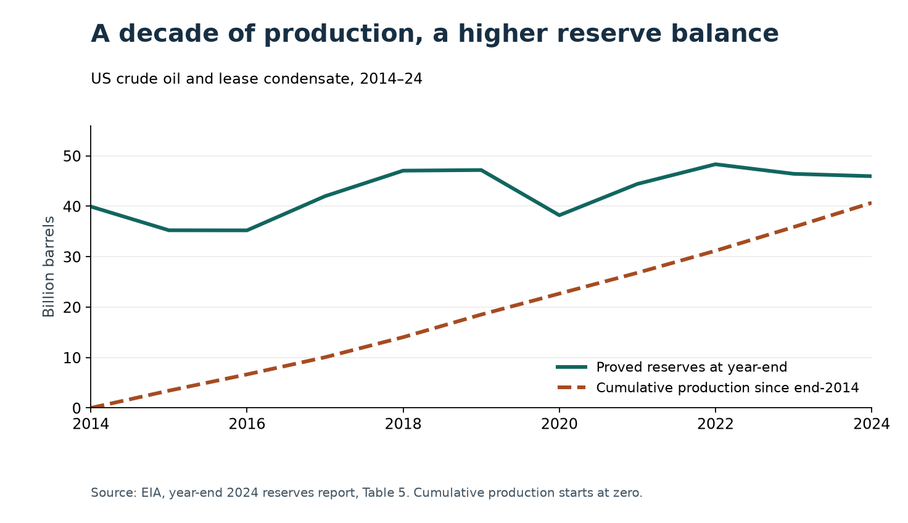

# Running out of oil

How soon could the world struggle to supply the oil people still need? This repository tests the reserve arithmetic, the timing of supply and demand, and the changing mix of uses. Each result is either a calculation on published data or a sensitivity to explicit assumptions.



## Reproduce

From the repository root, with Python 3.9 or newer:

```sh
make test
make evidence
```

The numerical work uses the Python standard library and the small source extracts in this checkout. For charts, install the optional plotting dependency in a virtual environment with `python -m pip install -e '.[figures]'`, then run `make figures PYTHON=python`. The checked-in figures were rendered with Matplotlib 3.11.2. Outputs are deterministic CSVs rounded to six decimals at export.

## Notebooks

Open [Reserves and production](notebooks/01-reserves-and-production.ipynb) for the historical stock and flow comparison, then [Supply and demand](notebooks/02-supply-and-demand.ipynb) to vary project delays, demand growth and end uses. Run all cells with a Python 3.9+ Jupyter kernel from the repository root or the notebooks directory. The notebooks call the same models as the command line.

## Experiments

| Question | Evidence and result |
| --- | --- |
| What does a global reserve ratio measure? | Five annual world crude ratios calculated within one OPEC bulletin vintage. In 2024 the ratio is 58.98 years at that year's production rate. [Annual results](outputs/world_history.csv) |
| Can booked reserves rise while oil is extracted? | End-2014 to end-2024 US reserve accounts. Production of 40.677 billion barrels accompanies a rise from 39.933 to 45.951 billion in booked reserves. [Annual reconciliation](outputs/us_history.csv) |
| What moves the timing of a capacity squeeze? | 54 ten-year paths vary capacity decline, annual commissioning, delivery delay and demand growth. In one flat-demand case delaying deliveries moves the first negative annual margin from year five to year two. [Scenario grid](outputs/sensitivity.csv) · [All annual observations](outputs/capacity_paths.csv) · [Figure](outputs/capacity-margin.png) |
| What might we keep using oil for? | 12 changes to road and petrochemical demand using a 2024 world baseline. Halving road use alone raises the petrochemical share from 14.95% to 19.21%. [Composition experiment](outputs/sector_mix.csv) |

[Methodology and limitations](docs/methodology.md) · [Data provenance](data/README.md) · [Scenario and access evidence](docs/context.md)

## Structure

`src/oil_evidence/` contains the models and CSV entry point. `tests/` contains independent arithmetic checks. `research/` renders the figures. `data/` holds the dated source extracts and `outputs/` holds their reproducible derivatives. Project Studio owns editorial decisions and Atlas owns the published article.
